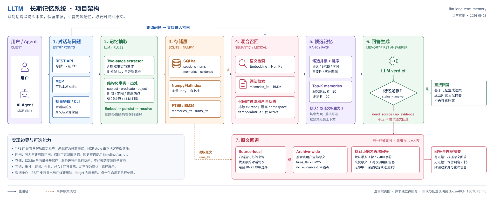

# LLTM — 面向 LLM Agent 的长期记忆系统

跨会话保存用户事实、追踪信息变化，并为后续问题检索相关记忆。
通过两阶段结构化抽取、时序事实更新与混合检索，结合原始对话证据构建回答上下文。

## 核心能力

- **跨会话检索**：找回历史对话中的用户事实与偏好。
- **时序事实更新**：区分新增、替换、终止和并存，保留历史版本，支持 `as_of(t)` 查询。
- **原文证据恢复**：按来源会话与轮次补回原话、数字和日期。
- **Agent 集成**：通过 REST、MCP、Python 或 CLI 读写用户范围内的长期记忆。

## Demo

[在线演示 →](https://lltm-memory.pages.dev/)

保存事实、在新会话中更新信息，并查看检索结果及选择原因。
在线 Demo 已启用真实 LLM 抽取、t4 回答与原文证据查看，提供跨会话记忆、事实变化和时间推理三个预设，也支持自定义输入。模型调用受演示额度限制，实际可用状态以页面提示为准。

## 技术架构



历史对话经两阶段事实抽取、去重与时间状态更新后，写入 SQLite 和 NumPy 向量索引。
查询结合 BM25 与向量召回选取记忆，再补充相关原文证据。

默认 `t4` 结合结构化长期记忆、约 4,000 token 的选择性原文检索、证据补全和时间处理，
构建有预算限制的上下文；**t4 不是 Full Context，不会把完整历史对话交给模型**。

**技术栈：** Python · FastAPI · Gemini · Sentence Transformers · SQLite / FTS5 · NumPy · MCP · Docker。

## 评测结果

LongMemEval-S 原 test100（100 道题）：最新回归在题目已暴露后，两组各运行三轮，回答与评分模型保持不变；
历史基准为测试时未见题目的单次评测。

| 评测批次 | 受测配置 | 正确率 | 中位上下文 Token |
|---|---|---:|---:|
| 最新回归 · 三轮均值 | LLTM v2 · 同期基线 | 68.67% | 574 |
| 最新回归 · 三轮均值 | LLTM t4 · 限定范围候选 | **86.00%** | 6,254.5 |
| 历史基准 · 单次 | Naive RAG | 65% | 12,763 |
| 历史基准 · 单次 | LLTM v2 | 72% | 574 |
| 历史基准 · 单次 | Full Context | 86% | 109,059 |

最新回归平均净提升 **17.33 个百分点**，成绩对应冻结 t4 候选配置，不是新的未见终测。
本轮未重跑 Full Context，两个 86% 来自不同实验，不能据此宣称同期追平或胜出。

最新回归中，t4 与同期 v2 回答＋评分已记录 token 分别为 2,465,965 和 476,864，约为 **5.17 倍**，
不含既有抽取及服务未报告的失败用量。

历史基准中 v2 与 Naive RAG 的上下文为字符估算，Full Context 使用服务返回的输入 token。

## 工程实现

- **服务与工具接入**：FastAPI 提供写入、检索、回答、时间线、导出与删除接口，附带 OpenAPI 和 Inspector；本地 MCP stdio 提供记忆读写、原文检索、时间线与遗忘工具。
- **用户隔离**：写入、检索及原文读取限定命名空间；配置认证后，REST Bearer Token 将请求绑定到租户身份。
- **测试与部署**：GitHub Actions 在 Linux、Windows、macOS 上运行测试，并执行 Ruff 检查；提供 Docker、Render 配置和 Cloudflare Pages 发布说明。
- **可复现评测**：冻结配置与源码哈希，支持断点续跑、调用及 token 记录和完整性审计。

## 快速开始

需要 Python 3.11+、uv 和 Gemini API Key。

```bash
git clone https://github.com/Mingjie-Mao/llm-long-term-memory.git
cd llm-long-term-memory
uv sync --group dev --extra api --extra llm --extra embed --extra mcp
```

在终端设置 `GEMINI_API_KEY`，或参照 `.env.example` 配置 `.env`，然后启动 API：

```bash
uv run uvicorn llm_long_term_memory.api.app:app --host 127.0.0.1 --port 8000
```

打开 [Inspector](http://localhost:8000/) 或 [API 文档](http://localhost:8000/docs)。
本地开放模式下，写入与提问使用同一个 `user_id`；对外提供服务前配置 REST 认证。

让本地 MCP 客户端在仓库目录启动 stdio 服务：

```bash
uv run lltm mcp
```

## 文档

- [Architecture · 架构说明](docs/ARCHITECTURE.md)
- [Evaluation · 评测方法与结果](docs/EVALUATION.md)
- [Project Report · 项目报告](docs/PROJECT_REPORT.md)
- [Deployment · 部署说明](DEPLOY.md)

## License

[MIT](LICENSE)
